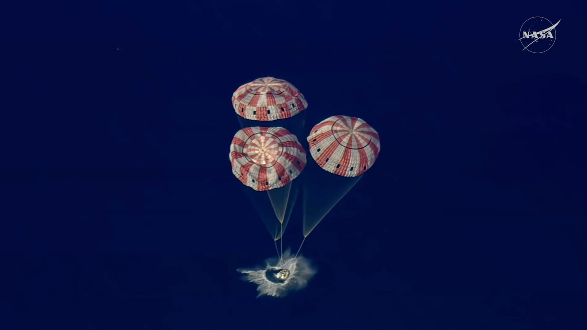
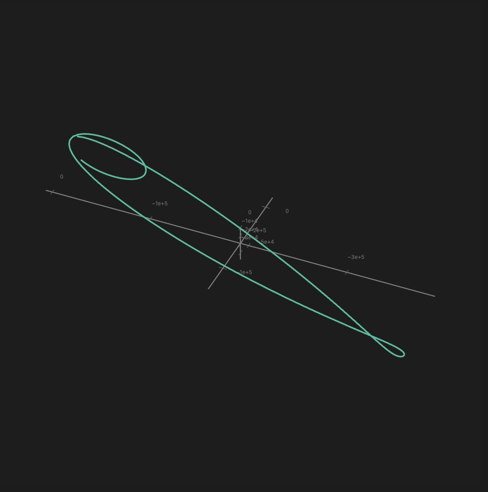
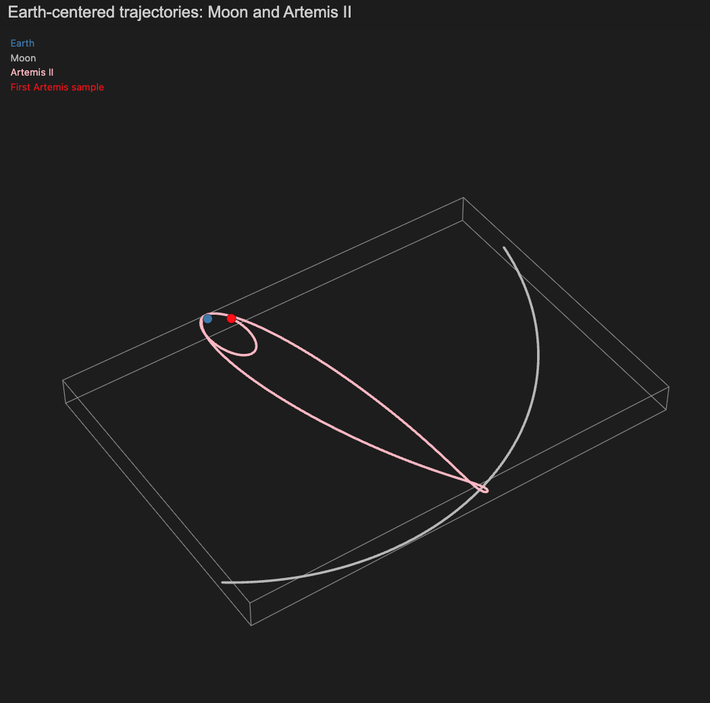
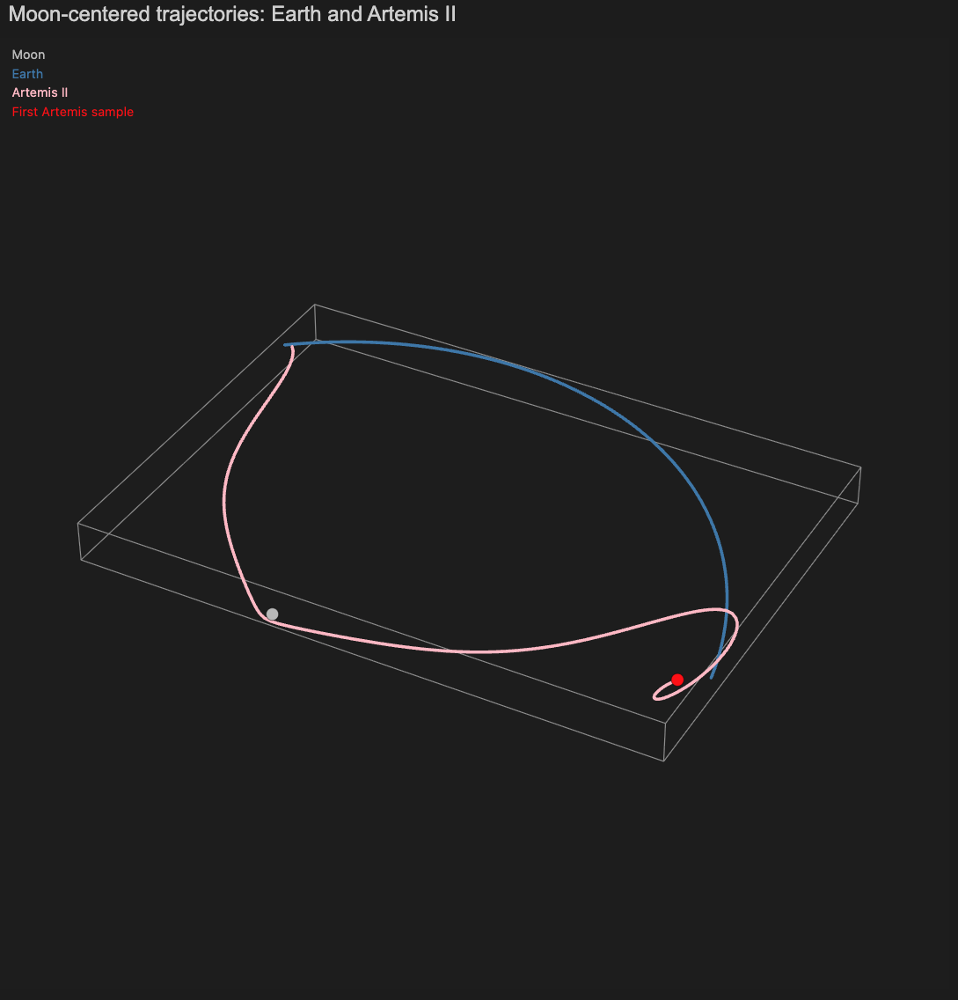

# Chasing the Moon

A short, Earth-centered view of the Moon and [Artemis II](https://en.wikipedia.org/wiki/Artemis_II) using [JPL Horizons](https://ssd.jpl.nasa.gov/horizons/), Raku, and [D3](https://d3js.org).  
*Data interval: 2–10 April 2026; coordinates are kilometres.*

----

## Why the Moon is usually approximately known

 The Moon’s orbit is **nearly circular** and **nearly flat**, which makes its motion predictable and easy to model. 
 However, its orbit is slightly **elliptical** (stretched out) and **inclined** (leaning), and it interacts with the 
 **Earth’s tilt**, **Earth’s rotation**, and **Earth’s axial tilt**. These subtle forces affect its path and are not 
 fully captured in simple approximations. Because the Moon is a **satellite of Earth**, its motion depends on Earth’s 
 position in space, and Earth’s orientation relative to the Sun also plays a role. Even though the Moon’s motion is 
 consistent, these complex interactions mean that while the orbit is roughly understood, precise predictions require 
 detailed data and advanced calculations.

 Consequently, an _ephemeris_ (table or diagram) can predict the **Moon's centre** at a specified time and reference frame. 

 In this document we use [Jet Propulsion Laboratory (JPL) Horizons System](https://ssd.jpl.nasa.gov/horizons/) via the Raku package ["WWW::HorizonsEphemerisSystem"](https://raku.land/zef:antononcube/WWW::HorizonsEphemerisSystem).

---

## Why landing is harder than finding the Moon

Landing on the Moon is hard because:
 - The Moon’s orbit is nearly circular but slightly elliptical and inclined, making its position unpredictable.  
   - The Moon is small, distant, and variable, so locating it is tricky.  
   - The Moon’s tilt and interaction with Earth’s rotation affect its movement.  
 - Landing requires knowing the lander’s position, velocity, attitude, and fuel margin, not just the Moon’s center.
 - The spacecraft must cancel orbital speed at the right time, estimate height and horizontal velocity during descent, and land in a safe area.  
 - Craters, slopes, rocks, dust, and low-angle sunlight or permanent shadows complicate camera-based navigation and hazard detection.  
   - Local gravity variations affect landing stability.

In other words: a good ephemeris gets a spacecraft to the neighborhood; onboard navigation and guidance make a touchdown safe.

[Artemis II](https://en.wikipedia.org/wiki/Artemis_II) was not a landing mission. It was a crewed Orion systems and operations test flight around the Moon and back. (Landing challenges are included here to show the "big picture" of flight trajectory calculations.)

---

## Libration is a different kind of motion

The Moon rotates once per orbit, so it keeps nearly the same face toward Earth. Yet it appears to nod, roll, and turn slightly: this is **libration**.
 
To summarize:

- **Longitude libration:** The elliptical orbit slows the Moon’s forward motion, causing tiny shifts in the direction it appears to move.
    - While Moon's elliptical orbit changes orbital speed, its spin rate stays nearly steady.
- **Latitude libration:** The Moon’s tilted orbit reveals different parts of its poles.  
- **Daily effect:** Our changing position on Earth adds small daily variations.  
- **Key point:** Libration does not cause large-scale wobble in the Moon’s path—it alters how we see it.

---

## Horizons and Artemis II

NASA JPL's [Horizons system](https://ssd.jpl.nasa.gov/horizons/manual.html) generates time-tagged positions, velocities, observing geometry, and related ephemerides for solar-system objects and selected spacecraft. The Raku package ["WWW::HorizonsEphemerisSystem"](https://raku.land/zef:antononcube/WWW::HorizonsEphemerisSystem) wraps its web API; ["JavaScript::D3"](https://raku.land/zef:antononcube/JavaScript::D3) renders the results in a [Jupyter notebook](https://raku.land/zef:antononcube/Jupyter::Chatbook).

Artemis II launched on 1 April 2026 and returned on 10 April after a roughly ten-day crewed free-return flight. 

The mission:
- Tested Orion and its crew operations in high Earth orbit
- Used trans-lunar injection
- Made trajectory-correction burns as needed
- Flew past the Moon
- Returned for Pacific splashdown. 

The free-return design used the Earth–Moon gravity field to provide a return path; it was a safety-minded trajectory (not a lunar landing). 

**Remark:** [NASA's mission report](https://assets.science.nasa.gov/content/dam/science/missions/artemis/artemis-ii-prelimsci-report-/Artemis%20II_Lunar%20Science%20Operations%20Report_2Oct2026.pdf) and [return announcement](https://www.nasa.gov/news-release/nasa-welcomes-record-setting-artemis-ii-moonfarers-back-to-earth/) give the mission chronology.

<---  -->


---

## Setup

The following code loads packages, setups visualization variables, and primes the Jupyter notebook for rendering JavaScript plots.

```raku
use WWW::HorizonsEphemerisSystem;
use JavaScript::D3;
use Data::TypeSystem;
use Data::Translators;

my $background = '#1F1F1F';
```

```raku, eval=FALSE
#% javascript
require.config({
  paths: {
    d3: 'https://d3js.org/d3.v7.min',
    d3_3d: 'https://unpkg.com/d3-3d@2.0.2/build/d3-3d'
  }
});

require(['d3', 'd3_3d'], function(d3, d3_3d) {
  window.d3 = d3;
  window.d33d = d3_3d || window.d33d || {};
});
```

---

## Query and plot

The following queries use Horizons identifiers `301` for the Moon and `@-1024` for Artemis II, with `399` (Earth) as the coordinate centre.

```raku
# Start, stop, and sample interval accepted by Horizons.
my @dates = (
    '2026-04-02 01:58:33',
    '2026-04-10 23:50:00',
    '10 m',
);
```

Get Artemis II (`@-1024`) trajectory data:

```raku
my @artemis-position = horizons-ephemeris-data(
    'state',
    ['@-1024', { center => '500@399', :@dates }],
    'position',
    :modifier<data>,
);

say "Artemis samples: {@artemis-position.elems}";
```

```raku, results=asis
my @field-names = 'Calendar Date (TDB)', 'Date', 'X', 'Y', 'Z', 'Vx', 'Vy', 'Vz';
@artemis-position.head(6)
==> to-html(:@field-names)
```

Each record has `X`, `Y`, and `Z` in kilometres. This first plot is Artemis II alone, relative to Earth.

```raku, eval=FALSE
#%js
js-d3-list-line-plot3d(
    @artemis-position.map(*<X Y Z>),
    :$background,
    box-ratios => Whatever,
    :900height,
    :900width,
    :axes,
    :!boxed,
)
```



Get Moon's center `@301` trajectory:

```raku
my @moon-position = horizons-ephemeris-data(
    'state',
    ['@301', { center => '500@399', :@dates }],
    'position',
    :modifier<data>,
);

say "Moon samples: {@moon-position.elems}";
```

### Combined Earth–Moon–Artemis II plot

Every vector below has `center => '500@399'`. Therefore the Earth marker is stationary by construction; the plot shows the Moon and spacecraft **relative to Earth**.

```raku, eval=FALSE
#%js
my @combined = (
    [0e0, 0e0, 0e0, 'Earth', 'point'],
    |@moon-position.map({ [|$_<X Y Z>, 'Moon', 'line'] }),
    |@artemis-position.map({ [|$_<X Y Z>, 'Artemis II', 'line'] }),
    [|@artemis-position.head<X Y Z>, 'First Artemis sample', 'point'],
).map({ <x y z group type>.Array Z=> $_.Array }).map(*.Hash);

js-d3-list-point-plot3d(
    @combined,
    background => $background,
    width => 800,
    height => 800,
    title => 'Earth-centered trajectories: Moon and Artemis II',
    :20title-font-size,
    box-ratios => Whatever,
    :boxed,
    :!axes,
    :!ticks,
    color-scheme => <SteelBlue Silver Pink Red>,
)
```



---

## Point of view of the chased

With similar code we can produce a Moon-centered plot:



---
## References 

### Packages

[AAp1] Anton Antonov, [WWW::HorizonsEphemerisSystem, Raku package](https://github.com/antononcube/Raku-WWW-HorizonsEphemerisSystem), (2026), [GitHub/antononcube](https://github.com/antononcube/).

[AAp2] Anton Antonov, [JavaScript::D3, Raku package](https://github.com/antononcube/Raku-JavaScript-D3), (2022-2026), [GitHub/antononcube](https://github.com/antononcube/).

### Sources

- [JPL Horizons manual](https://ssd.jpl.nasa.gov/horizons/manual.html)
- [NASA: Artemis II mission report](https://assets.science.nasa.gov/content/dam/science/missions/artemis/artemis-ii-prelimsci-report-/Artemis%20II_Lunar%20Science%20Operations%20Report_2Oct2026.pdf)
- [NASA: Artemis II return announcement](https://www.nasa.gov/news-release/nasa-welcomes-record-setting-artemis-ii-moonfarers-back-to-earth/)
- [NASA: explanation of lunar libration](https://science.nasa.gov/moon/moon-phases/)
- [NASA: lunar South Pole terrain and lighting](https://www.nasa.gov/reference/moonbase-environment/)