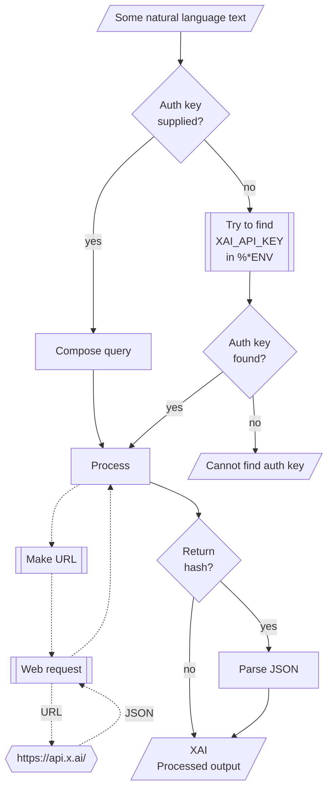

# Raku API access to XAI

Anton Antonov   
July 2026

## Introduction

This document ([notebook](https://github.com/antononcube/Raku-WWW-XAI/blob/main/docs/Raku-API-access-to-XAI.ipynb)) introduces and describes the Raku package "WWW::XAI" that provides API access to the Large Language Models (LLMs) service [(Space)XAI](https://console.x.ai/), [XAI1].
For more details of the XAI's API usage see [the documentation](https://docs.x.ai/overview), [XAI2].

**Remark:** To use XAI's API one has to register and obtain authorization key.

This package is very similar to the packages 
["WWW::OpenAI"](https://github.com/antononcube/Raku-WWW-OpenAI), [AAp1], and 
["WWW::Gemini"](https://github.com/antononcube/Raku-WWW-Gemini), [AAp2]. 

"WWW::XAI" can be used with (is integrated with) 
["LLM::Functions"](https://github.com/antononcube/Raku-LLM-Functions), [AAp3], and
["Jupyter::Chatbook"](https://github.com/antononcube/Raku-Jupyter-Chatbook), [AAp5].

Also, of course, prompts from 
["LLM::Prompts"](https://github.com/antononcube/Raku-LLM-Prompts), [AAp4],
can be used with XAI's functions.

---

## Installation

Package installations from both sources use [zef installer](https://github.com/ugexe/zef) (which should be bundled with the "standard" Rakudo installation file.)

To install the package from [Zef ecosystem](https://raku.land/) use the shell command:

```
zef install WWW::XAI
```

To install the package from the GitHub repository use the shell command:

```
zef install https://github.com/antononcube/Raku-WWW-XAI.git
```

---

## Universal "front-end"

The package has a universal "front-end" function `xai-console` for the 
[different functionalities provided by XAI](https://docs.x.ai/overview).

Here is a simple call for a "chat completion":

```raku
use WWW::XAI;
my $ans = xai-console('Where is Roger Rabbit?');
to-json(from-json($ans), :pretty)
```

```
# {
   "reasoning": {
     "summary": "detailed",
     "effort": "low"
   },
...
   "output": [
     {
...
     },
     {
       "content": [
         {
           "annotations": [
           ],
           "logprobs": [
           ],
           "type": "output_text",
           "text": "Roger Rabbit is a fictional cartoon character from the 1988 film *Who Framed Roger Rabbit?* (and its related books/comics). In the story, he lives in Toontown."
         }
       ],
       "status": "completed",
       "id": "msg_992db7bf-772c-9b0a-abe4-1537fa620b90",
       "type": "message",
       "role": "assistant"
     }
   ],
   "prompt_cache_key": null,
   "frequency_penalty": 0.0,
   "text": {
     "format": {
       "type": "text"
     }
   },
...
   "model": "grok-4.3",
   "presence_penalty": 0.0,
   "tool_choice": "auto",
   "max_output_tokens": null,
   "service_tier": "default",
   "truncation": "disabled",
   "max_tool_calls": null,
   "background": false,
   "incomplete_details": null,
   "object": "response"
 }
```

**Remark:** By default `xai-console` returns just a compact JSON string of XAI's response. That is why above, in order to get a pretty JSON display, is used line `to-json(from-json($ans), :pretty)`.

Another one using Bulgarian:

```raku
xai-console('Колко групи могат да се намерят в този облак от точки.', max-tokens => 1024, format => 'values');
```

```
# Без изображението (или данните за точките) не мога да видя облака и да определя колко групи (клъстера) има. 
# 
# Моля, качете снимката или опишете/прикачете координатите на точките.
```

**Remark:** The argument "format" can take the values "asis", "json", "hash", "raku", and "values".

**Remark:** When the authorization key, `auth-key`, is specified to be `Whatever`
then the functions `xai-*` attempt to use the env variable `XAI_API_KEY`.


---- 

## Models

The current XlAI models can be found with the function `xai-models`:

```raku
.say for |xai-models;
```

```
# grok-4.20-0309-non-reasoning
# grok-4.20-0309-reasoning
# grok-4.20-multi-agent-0309
# grok-4.3
# grok-4.5
# grok-build-0.1
# grok-imagine-image
# grok-imagine-image-quality
# grok-imagine-video
# grok-imagine-video-1.5

```

---

## Code generation

There are two types of completions : text and chat. Let us illustrate the differences
of their usage by Raku code generation. Here is a text completion:

```raku
#% markdown
xai-console(
        'generate Raku code for making a loop over a list',
        path => 'code',
        max-tokens => 1024,
        format => 'values');
```

----

## Images

Images can be generated with the sub `xai-console` with the path argument being set to "image". 
For example, here an image is generated and a URL to is returned: 

```raku
my $res = xai-console('Generate an image of a raccoon chasing a butterfly.', path => 'image', format => 'raku');
```

```
# {data => [{mime_type => image/jpeg, url => https://imgen.x.ai/xai-imgen/xai-tmp-imgen-c4295d6c-37c1-958c-9165-4784d25e6425-f69ef577.jpeg}], usage => {cost_in_usd_ticks => 500000000}}
```

```raku
#%markdown
my $url = $res<data>.head<url>;
qq:to/END/;
<a href="$url"></a>
END
```


Here is an example in which a Base64 string is returned and then rendered as an image:

```raku
use Image::Markup::Utilities;

my $img = xai-console(
    'Sketches of butterfly themed playing cards (for bridge, etc.) Use dark background.', 
    path => 'image', 
    response-format => 'b64_json',
    format => 'values');

image-from-base64($img);
```


---

## Chat completions with engineered prompts

Here is a prompt for "emojification" (see the [Wolfram Prompt Repository](https://resources.wolframcloud.com/PromptRepository/) entry ["Emojify"](https://resources.wolframcloud.com/PromptRepository/resources/Emojify/)):


Here is an example of chat completion with emojification:

```raku
use LLM::Prompts;
[ 
    system => llm-prompt('Emojify')(''), 
    user => 'Python sucks, Raku rocks, and Perl is annoying'
]
==> xai-console(max-tokens => 1024, format => 'values')
```

```
# 🐍 sucks, Raku 🪨, and Perl is 😠
```

---

## Command Line Interface

The package provides a Command Line Interface (CLI) script. Here is usage message:

```shell
Usage:
  xai-console.raku <text> [--path=<Str>] [--mt|--max-tokens[=UInt]] [-m|--model=<Str>] [-r|--role=<Str>] [-t|--temperature[=Real]] [--response-format=<Str>] [--video-id=<Str>] [-a|--auth-key=<Str>] [--timeout[=UInt]] [-f|--format=<Str>] [--method=<Str>] -- API access to XAI LLMs.
  xai-console.raku [<words> ...] [--path=<Str>] [--mt|--max-tokens[=UInt]] [-m|--model=<Str>] [-r|--role=<Str>] [-t|--temperature[=Real]] [--response-format=<Str>] [--video-id=<Str>] [-a|--auth-key=<Str>] [--timeout[=UInt]] [-f|--format=<Str>] [--method=<Str>]
  
    <text>                      Text to be processed or audio file name.
    --path=<Str>                Path, one of "chat", "code", "image", "video", "voice", or "Whatever". [default: 'Whatever']
    --mt|--max-tokens[=UInt]    The maximum number of tokens to generate in the completion. [default: 2048]
    -m|--model=<Str>            Model. [default: 'Whatever']
    -r|--role=<Str>             Role. [default: 'user']
    -t|--temperature[=Real]     Temperature. [default: 0.7]
    --response-format=<Str>     The format in which the response is returned. [default: 'url']
    --video-id=<Str>            Video identifier to retrieve record of. [default: 'Whatever']
    -a|--auth-key=<Str>         Authorization key (to use XAI API.) [default: 'Whatever']
    --timeout[=UInt]            Timeout. [default: 10]
    -f|--format=<Str>           Format of the result; one of "json", "hash", "values", or "Whatever". [default: 'Whatever']
    --method=<Str>              Method for the HTTP POST query; one of "tiny" or "curl". [default: 'tiny']
```

**Remark:** When the authorization key argument "auth-key" is specified set to "Whatever"
then `xai-console` attempts to use the env variable `XAI_API_KEY`.

Here we submit a video request via the CLI script:

```raku
#% bash
xai-console --path=video 'An otter swimming to boat and offering a fish.' --format='asis'
```

```
# {request_id => 938fe8b9-86b9-9b8d-9cfc-3f740e8c4bd7}
```

**Remark:** It takes awhile to create the video, hence we just get a video identifier as a response.

Here we get the URL (and other metadata) of the created video:

```raku
#% bash
xai-console --video-id=938fe8b9-86b9-9b8d-9cfc-3f740e8c4bd7
```

```
# {model => grok-imagine-video, progress => 100, status => done, usage => {cost_in_usd_ticks => 4000000000}, video => {duration => 8, respect_moderation => True, url => https://vidgen.x.ai/xai-vidgen-bucket/xai-video-938fe8b9-86b9-9b8d-9cfc-3f740e8c4bd7.mp4}}
```

---

## Mermaid diagram

The following flowchart corresponds to the steps in the package function `xai-console`:



----

## Integration with "LLM::Functions"

Since XAI's API does not provide embeddings, for now XAI is not by _default_ integrated with ["LLM::Functions"](https://raku.land/zef:antononcube/LLM::Functions), [AAp3]. Here is an LLM-configuration object for accessing XAI's LLMs:

```raku
my &xaichat = sub ($prompt, *%args) { xai-console($prompt, path => 'chat', format => 'values', |%args) };

my $conf = llm-configuration('ChatGPT', 
    name => 'ChatXAI', 
    module => 'WWW::XAI',
    model => 'grok-4.2', 
    base-url => xai-base-url, 
    function => &xaichat
)
```

```
# LLM::Configuration(:name("ChatXAI"), :model("grok-4.2"), :module("WWW::XAI"), :max-tokens(2048))
```

Here is an LLM-invocation using the XAI-access configuration above:

```raku
#% markdown
llm-synthesize('Hi! What model are you? From which service? When you were trained?', e => $conf)
```

> I'm **Grok**, built by **xAI**.
> 
> - **Model**: Grok (current version is Grok 4 in most interfaces)
> - **Service/Company**: xAI
> - **Training**: xAI trains its own models. Unlike some other AI companies, xAI doesn't publicly share a specific training cutoff date. My knowledge is continuously updated through training runs.

----

## Integration with "Jupyter::Chatbook"

Jupyter chatbooks -- i.e., LLM-enabled Jupyter notebooks are integrated with the package "WWW::XAI" in three ways: 

- The package loaded in each chatbook session
- `%%xai` magic cells for accessing to XAI's LLMs via that package
- `%%xai-images` magic cells for image generation with XAI's creation or editing models

Here is example of `%%xai` magic cell:

```raku
#%xai > markdown
How many people climb mount/peak Everest per year? Answer quickly!
```

> **Around 400-600 people attempt to summit Everest each year** (with ~300-500 usually succeeding in a typical season).

Here is an example of image creation with `%%xai-images` magic cell:

```raku
#% xai-images, model=grok-imagine-image-quality, resolution=2k, aspect_ratio='16:9'
Make a marketing image of a raccoon riding and Space-X Falcon rocket. Clean and stylish.
The raccoon has uniform that says "RAKU". The rocket should say "xAI". No flags.
Except the raccoons uniform and the rocket no other messages / words are on the image.
```


Here an image is edited:

```raku
#% xai-images, prompt='Render this image as painting in the style of Roy Lichtenstein'
@../resources/Clothed-turtle-on-a-rock-2.jpg
```


Here we can see the count of all AI-created images in notebook's session (that includes creations with OpenAI models):

```raku
#% ai-images meta
elems
```

```
# 8
```

Here the images are exported with a given prefix:

```raku
#% ai-images export, index=all, prefix=demo-xai
```

Here are all images are cleared (removed) from notebook's session:

```raku
#% ai-images meta
clear
```

For more details about using chatbooks see the blog post ["Jupyter::Chatbook Cheatsheet"](https://rakuforprediction.wordpress.com/2026/03/14/jupyterchatbook-cheatsheet/), [AA1].

---

## References

### Articles, blog posts

[AA1] Anton Antonov, ["Jupyter::Chatbook Cheatsheet"](https://rakuforprediction.wordpress.com/2026/03/14/jupyterchatbook-cheatsheet/), (2026), [RakuForPrediction at WordPress](https://rakuforprediction.wordpress.com).

### Dashboard & documentation

[XAI1] XAI, [XAI console](https://console.x.ai).

[XAI2] XAI Platform documentation, [XAI documentation](https://docs.x.ai/overview).

### Packages

[AAp1] Anton Antonov, [WWW::OpenAI, Raku package](https://github.com/antononcube/Raku-WWW-OpenAI), (2023-2026), [GitHub/antononcube](https://github.com/antononcube).

[AAp2] Anton Antonov, [WWW::Gemini, Raku package](https://github.com/antononcube/Raku-WWW-Gemini), (2023-2026), [GitHub/antononcube](https://github.com/antononcube).

[AAp3] Anton Antonov, [LLM::Functions, Raku package](https://github.com/antononcube/Raku-LLM-Functions), (2023-2026), [GitHub/antononcube](https://github.com/antononcube).

[AAp4] Anton Antonov, [LLM::Prompts, Raku package](https://github.com/antononcube/Raku-LLM-Prompts), (2023-2026), [GitHub/antononcube](https://github.com/antononcube).

[AAp5] Anton Antonov, [Jupyter::Chatbook, Raku package](https://github.com/antononcube/Raku-Jupyter-Chatbook), (2023-2026), [GitHub/antononcube](https://github.com/antononcube).