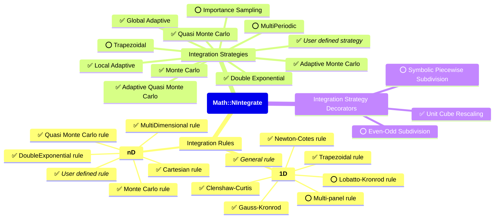
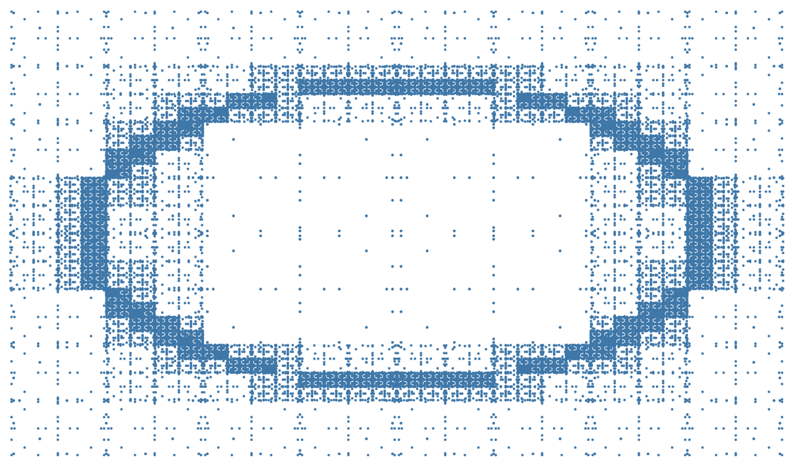
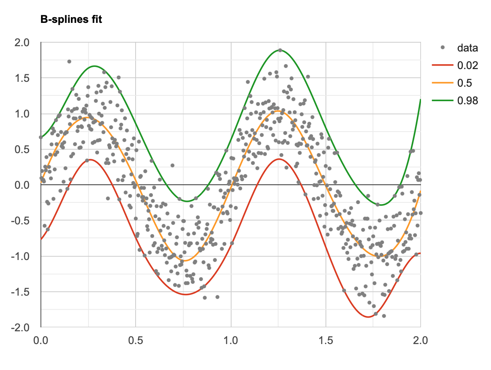

# Three Big Advancements in Raku Numerics

Anton Antonov
November 2026

## Introduction 

This blog post describes three big advancements in Raku's numerical algorithms packages:

1. **Extensible numerical integration** with ["Math::NIntegrate"](https://raku.land/zef:antononcube/Math::NIntegrate);
2. **Optimization support** through `COIN-OR` and ["Math::Optimization"](https://raku.land/zef:antononcube/Math::Optimization); and
3. **Quantile regression and regression workflows** through ["Math::QuantileRegression"](https://raku.land/zef:antononcube/Math::QuantileRegression) and ["Math::Regressionizer"](https://raku.land/zef:antononcube/Math::Regressionizer).

“Big advancements” is used here in a Raku-ecosystem functionalities sense. But more generally speaking, the advancement is the increasing availability of extensible APIs, higher-level workflows, and connections between numerical algorithms.

A second theme is the role of large language models (LLMs) and Artificial Intelligence (AI) agents in developing numerical software. In my experience, they helped with wrappers, translations, repetitive code, and parts of the test suites. They did not replace mathematical design and numerical validation (for me, at this point). 

**Remark:** More detailed posts on these new(er) Raku functionalities will follow in the next few months.

**Remark:** [Here](https://github.com/antononcube/RakuForPrediction-blog/blob/main/Markdown/LLM-ext-Three-big-advancements-in-Raku-numerics.md) 
is an extended, wordier version of blog post derived via a ["blog-writer"](https://github.com/antononcube/Python-GoogleADK-agents/tree/main/blog-writer) AI-agent. 

**Remark:** With my LLM-usage explanations below, I am not trying to imply that human work remains essential for API design, numerical validation, cross-language reconciliation, and documentation.
So far, I have chosen to do those by myself. But I would be very interested if that kind of work can be completely outsourced to AI-agents, and the related methodological and philosophical implications. 

**Remark:** The headline image shows regression quantiles fitted over numerical integration sampling points.

---

## Numerical integration

[`Math::NIntegrate`](https://github.com/antononcube/Raku-Math-NIntegrate) is a Raku numerical-integration library whose main function, `nintegrate`, is functionally and architecturally modeled on Wolfram Language’s `NIntegrate`.

The important development is not simply the presence of several quadrature algorithms. An extensible framework is provided in which integration rules, strategies, regions, variable transformations, stopping criteria, and monitors can be combined. The framework has an object-oriented design and implementation which also allows user-defined integration strategies and rules to be hooked-up to it.


### Rules, composite rules, and strategies

The package has one-dimensional rules such as Clenshaw–Curtis, Gauss–Kronrod, and Trapezoidal rules.

It also has multidimensional and composite approaches, including Cartesian, double-exponential, Monte Carlo, and quasi-Monte Carlo methods. A Cartesian rule can combine component rules across dimensions or regions.

A **rule** supplies an approximation scheme. A **strategy** controls how that rule is applied—for example, how regions are subdivided, how estimates are adapted, or how termination is monitored. A **composite rule** is itself made from one or more component rules.

The framework has a nesting model of specifying integration algorithm instances:

- a strategy decorator has a strategy;
- a strategy that is not a decorator has a rule; and
- a composite rule, such as a Cartesian rule, has one or more component rules.

This distinction is useful because it separates numerical approximation from the control logic surrounding it.

Framework's architecture uses object-oriented [Design Patterns](https://en.wikipedia.org/wiki/Design_Patterns), including Strategy, Composite, Decorator, Template Method, Builder, Interpreter, and Abstract Factory.

The package supports multiple stopping criteria and integration monitors. Depending on the selected method, a computation may be controlled by accuracy goals, precision goals, recursion limits, region counts, or monitoring logic. User-defined rules and strategies can also be connected to the framework when they satisfy the relevant interfaces.

The following mind-map gives an overview of the "Math::NIntegrate" algorithms:



Here is a fairly comprehensive numerical integration specification integrates a constant function over a region that is an ellipse:

```raku
use Math::NIntegrate;

my ($c, $d) = 2.5, 1.5;
nintegrate(
        { (($^x / 2) ** 2 + ( $^y ) ** 2 < 1).Int }, 
        ['x', -$c, $c], ['y', -$d, $d],
        method => ('local-adaptive', singularity-depth => Inf, method => ('multidimensional-rule', generators => 9)),
        max-recursion => 7,
        min-recursion => 2,
        precision-goal => 3.2
    ):pairs
```

Here are the corresponding sampling points:



### Natural-language integration workflows

[`DSL::English::IntegrationWorkflows`](https://github.com/antononcube/Raku-DSL-English-IntegrationWorkflows) translates English-like integration specifications into Raku or Wolfram Language code. For example:

```raku
use DSL::English::IntegrationWorkflows;
use MONKEY-SEE-NO-EVAL;

my $cmd= 'numerically integrate 1/sqrt(x) over the range [0,1] without singularity handling with up to 20 recursion levels';

my $translated = ToIntegrationWorkflowCode($cmd, 'Raku::Ecosystem');

say (:$translated);
say $translated.EVAL
```

**Remark:** The package "DSL::English::IntegrationWorkflows" supports the generation of Wolfram Language code and translation to Bulgarian and Russian. 

### Use of LLMs

I wanted to implement most of "Math::NIntegrate" myself, especially the:

- the object-oriented architecture;
- integration strategies;
- the connections between regions, rules, and variable transformations; and
- the framework for composing strategies and rules.

For some integration rules, I used simple LLM-assisted code generation. AI agents also helped create parts of the test suite.

The multidimensional rules were initially translated from FORTRAN to Raku. That translation contained many errors. The resulting code required manual correction, additional regeneration, and numerical testing. Numerical translation is not merely a change of syntax: indexing conventions, normalization factors, endpoint treatment, and precision assumptions all have to be checked.

---

## Optimization

Raku can access parts of the [COIN-OR](https://www.coin-or.org/) optimization ecosystem through the package [`COIN-OR`](https://github.com/antononcube/Raku-COIN-OR).

COIN-OR is an ecosystem containing several optimization projects and native solvers. The Raku binding should not be understood as a binding to every COIN-OR project or as a guarantee that every solver backend is available on every platform. The native functionality exposed depends on the package version, installed libraries, and platform configuration.

[`Math::Optimization`](https://github.com/antononcube/Raku-Math-Optimization) provides a higher-level Raku interface which can have multiple backends (like, COIN-OR or Gurobi). A linear programming demonstration follows.

Consider this problem: minimize $x + y$, subject to constraint $x + 2 * y ≥ 3$ and lower bounds $2 ≥ x ≥ -1$, $1 ≥ y ≥ -1$.

Here is the solution with `linear-programming` (provided by "Math::Optimization"):

```raku
use Math::Optimization;
linear-programming([1, 1], [(1, 2),], [3,], [[-1, 2], [-1, 1]])
```

### Use of LLMs

The Raku interfaces to COIN-OR and, at an earlier stage, Gurobi were generated with AI-agent assistance using relatively generic prompts. (Currently, Gurobi-related code should not be assumed to be part of the supported interface.)

For "Math::Optimization", I first prepared a _complete_ specification of `linear-programming`. (See, [`LinearProgramming.md`](https://github.com/antononcube/Raku-Math-Optimization/blob/main/docs/LinearProgramming.md), which defines intended conventions for objective coefficients, constraints, bounds, and returned values.)

Manual and AI-assisted changes were later made to the optimization packages, including changes intended to improve work with large and sparse constraint matrices. In my workflows, those changes made optimization-backed packages such as "Math::QuantileRegression" and "Math::Regressionizer" more useful (because they become faster).

The practical lesson is that an AI agent can accelerate wrapper development, but the mathematical contract should be written first and the generated implementation tested against independently understood examples.

---

## Quantile Regression

QuantileRegression (QR) provides multiple advantages over the other types of regression, like, Least Squares Fitting, Local regression (LOESS), and others.
QR is robust to outliers, allows the finding of point- and variance anomalies, and can be used to compute conditional Cumulative Distribution Functions.  

The core Raku package ["Math::QuantileRegression"](https://raku.land/zef:antononcube/Math::QuantileRegression) uses the packages ["Math::Splines"](https://raku.land/zef:antononcube/Math::Splines) and ["Math::Polynomial::Chebyshev"]((https://raku.land/zef:antononcube/Math::Polynomial::Chebyshev)) for function bases construction and "Math::Optimization" to fit those bases to data.

The package ["Math::Regressionizer"](https://raku.land/zef:antononcube/Math::Regressionizer) provides monadic pipelines that allow rapid specification of regression workflows with operations including:

- Data summaries and rescaling
- Quantile regression computation
- Least-squares fitting 
- Outlier finding with several methods
- Conditional-CDF reconstruction
- Signal simulation
- Plotting data, fits, residuals, outliers, and CDF-related results

Here is "noisy sinusoidal" random data:

```raku
use Data::Generators;
use Data::TypeSystem;

srand(0);
my @x = 0, 0 + 1/300 ... 2;
my @y = @x.map({ sin(2 * pi * $_) }) <<+>> random-variate(NormalDistribution.new(0, 0.4), @x.elems);
my @data = @x Z @y;
deduce-type(@data):tally;
```

Here is a pipeline that fits the B-spline basis of 8 knots to the probabilities 0.02, 0.5, and 0.98:

```raku
use Math::Regressionizer;

my $obj = 
  Math::Regressionizer.new(@data)
  .echo-data-summary
  .quantile-regression(knots => 8, probs => [0.02, 0.5, 0.98])
  .outliers()
  .echo-value(with => {say "outlier counts: ", $_>>.elems} )
```

Here is plot of the data and fitted *regression quantiles*:


```raku
$obj.plot(title => "B-splines fit", format => 'html').take-value
==> spurt("qr-plot.html")
```



The package ["DSL::English::QuantileRegressionWorkflows"](https://raku.land/zef:antononcube/DSL::English::QuantileRegressionWorkflows) was extended to generate Raku code.
The package ["DSL::Examples"](https://raku.land/zef:antononcube/DSL::Examples) is also "Raku-aware" when comes to regression. 

### Use of LLMs

I wrote the initial versions of "Math::QuantileRegression" semi-manually, with AI-agent assistance for translating selected Wolfram Language code fragments. Considerable human programming was required to connect basis construction, optimization, fitted functions, and workflow-level results.

A substantial amount of manual and AI-assisted work also went into the guide [*Quantile Regression with B-splines*](https://github.com/antononcube/Raku-Math-QuantileRegression/blob/main/docs/Quantile-Regression-with-B-splines.md). Writing the guide exposed ambiguities in both the implementation and the API.

The initial version of "Math::Regressionizer" was generated from the Python package [`Regressionizer`](https://pypi.org/project/Regressionizer/). It was subsequently adjusted while writing the [regression-workflow guide](https://github.com/antononcube/Raku-Math-Regressionizer/blob/main/docs/Rapid-specification-of-regression-workflows.ipynb).

---

## References

[AAp1] Anton Antonov, 
[Math::NIntegrate, Raku package](https://github.com/antononcube/Raku-Math-NIntegrate),
(2026),
[GitHub/antononcube](https://github.com/antononcube).

[AAp2] Anton Antonov,
[DSL::English::IntegrationWorkflows, Raku package](https://github.com/antononcube/Raku-DSL-English-IntegrationWorkflows),
(2026),
[GitHub/antononcube](https://github.com/antononcube).

[AAp3] Anton Antonov,
[Math::Polynomial::Chebyshev, Raku package](https://github.com/antononcube/Raku-Math-Polynomial-Chebyshev),
(2024),
[GitHub/antononcube](https://github.com/antononcube).

[AAp4] Anton Antonov,
[Math::Splines, Raku package](https://github.com/antononcube/Raku-Math-Splines),
(2024-2026),
[GitHub/antononcube](https://github.com/antononcube).

[AAp5] Anton Antonov,
[COIN-OR, Raku package](https://github.com/antononcube/Raku-COIN-OR),
(2026),
[GitHub/antononcube](https://github.com/antononcube).

[AAp6] Anton Antonov,
[Math::Optimization, Raku package](https://github.com/antononcube/Raku-Math-Optimization),
(2026),
[GitHub/antononcube](https://github.com/antononcube).

[AAp7] Anton Antonov,
[Math::QuantileRegression, Raku package](https://github.com/antononcube/Raku-Math-QuantileRegression),
(2026),
[GitHub/antononcube](https://github.com/antononcube).

[AAp8] Anton Antonov,
[Math::Regressinizer, Raku package](https://github.com/antononcube/Raku-Math-Regressionizer),
(2026),
[GitHub/antononcube](https://github.com/antononcube).

[AAp9] Anton Antonov,
[DSL::English::QuantileRegressionWorkflows, Raku package](https://github.com/antononcube/Raku-DSL-English-QuantileRegressionWorkflows),
(2022-2026),
[GitHub/antononcube](https://github.com/antononcube).

---

## Sources

More details about the packages can be found in these Markdown files;

- Math::NIntegrate : https://raw.githubusercontent.com/antononcube/Raku-Math-NIntegrate/refs/heads/main/README.md
- Math::QuantileRegression : https://raw.githubusercontent.com/antononcube/Raku-Math-QuantileRegression/refs/heads/main/README.md
- Math::Optimization :  https://raw.githubusercontent.com/antononcube/Raku-Math-Optimization/refs/heads/main/README.md
- Math::Regressionizer : https://raw.githubusercontent.com/antononcube/Raku-Math-Regressionizer/refs/heads/main/README.md